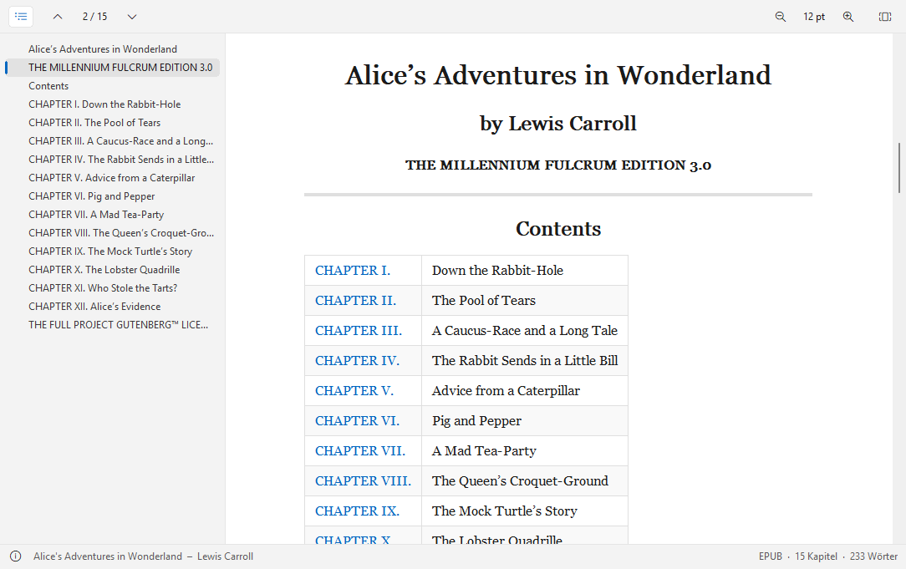

# eReader

[English](README.md) | **Deutsch**

Ein Betrachter für PDF, E-Books und Comics (Lister-Plugin) für den [Total Commander](https://www.ghisler.com), 32 und 64 Bit.
F3 auf einer PDF-, EPUB-, FB2-, MOBI/AZW3- oder CBZ-Datei, und sie lässt sich direkt lesen – schnell und sparsam, mit Inhaltsverzeichnis, Textsuche, Links und dunklem Design.
PDF-Seiten zeichnet Windows selbst, E-Books werden als fließender Text in einer angenehmen Lesespalte gesetzt. Nativ, keine Laufzeitumgebung, nichts zu installieren außer dem Plugin.

## Unterstützte Dateien

- **PDF:** `.pdf` – auch kennwortgeschützte und beschädigte Dateien
- **EPUB:** `.epub`, `.kepub`
- **FictionBook:** `.fb2`, `.fbz`
- **Mobipocket und Kindle:** `.mobi`, `.azw`, `.azw3`, `.prc`, `.pdb` – MOBI 6, KF8, PalmDOC; Bücher mit Kopierschutz (DRM) können nicht angezeigt werden
- **Comics:** `.cbz`

## Funktionen

- Inhaltsverzeichnis in einer Seitenleiste: PDF-Lesezeichen, Kapitel und Überschriften von E-Books
- Klickbare Links: Sprünge im Dokument, zurück mit Alt+Links, Webadressen öffnen sich im Browser
- Gehe zu Seite oder Kapitel, Seitenzähler in der Werkzeugleiste, Position im Lister-Titel
- PDF: Seitenbreite, ganze Seite, Originalgröße und freier Zoom; unterschiedlich große Seiten werden einzeln eingepasst
- E-Books: größere und kleinere Schrift, wählbare Schriftart, schmale Textspalte, Bilder, Tabellen und Fußnoten
- Text markieren und kopieren, auch in PDFs mit Textebene
- Miniaturansichten für die Thumbnail-Ansicht des Total Commander (Cover oder erste Seite)
- Helles und dunkles Design (automatisch wie Windows oder fest) im Windows-11-Look; im dunklen Design lassen sich auch PDF-Seiten abdunkeln
- Seiten werden im Hintergrund gezeichnet: Der Lister bleibt bedienbar, auch bei großen Büchern
- Statusleiste mit Titel, Autor, Format und Seiten- bzw. Kapitelzahl
- Oberfläche auf Deutsch und Englisch (richtet sich nach der Windows-Sprache)

## Download und Installation

1. **`eReader.zip`** aus der [neuesten Version](https://github.com/naderi/ereader/releases/latest) herunterladen.
2. Die ZIP-Datei im Total Commander öffnen (Enter auf der Datei) und die Frage nach der Installation des Plugins bestätigen.

Die Einstellungen liegen in `eReader.ini` neben dem Plugin. Voraussetzung ist Windows 10 oder 11 (PDF-Seiten zeichnet die in Windows eingebaute PDF-Engine).

## Tasten

| Taste | Aktion |
|---|---|
| F12 oder Strg+T | *Inhaltsverzeichnis* (Seitenleiste) |
| Strg+G | *Gehe zu Seite…* / *Gehe zu Kapitel…* |
| Alt+Links | *Zurück* |
| Strg+1 / Strg+2 / Strg+0 | PDF: *Seitenbreite* / *Ganze Seite* / *Originalgröße* |
| Strg+Plus / Strg+Minus | PDF: *Vergrößern* / *Verkleinern* (auch Strg+Mausrad); E-Books: *Größere Schrift* / *Kleinere Schrift* |
| Strg+D | *Seiten abdunkeln* (PDF im dunklen Design) |
| Strg+A, Strg+C | *Alles markieren*, *Kopieren* |
| F7 | Suchen (Suche des Total Commander) |
| F1 | Info |

Weitere Optionen – *Design*, *Schriftart…*, *Schmale Textspalte* – stehen im Kontextmenü (Rechtsklick).

## Lizenz

Freeware – kostenlos nutzbar, aber **nicht verkäuflich**. Siehe [LICENSE](LICENSE).

## Unterstützung

Wenn eReader dir Zeit spart, kannst du die Entwicklung auf Ko‑fi unterstützen. ☕

---

© 2026 [Ali Naderi](https://github.com/naderi) · [digitalent.dev](https://digitalent.dev/de/)
