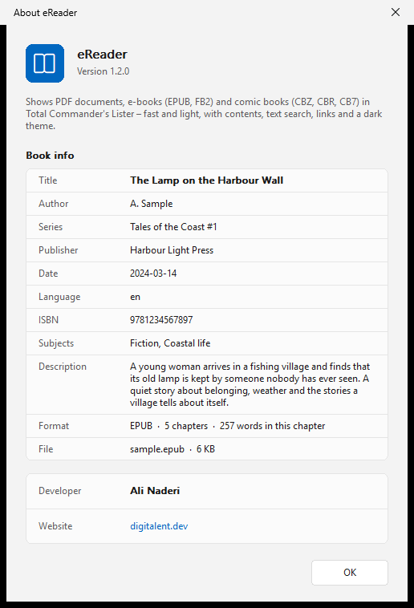

# eReader

**English** | [Deutsch](README.de.md)

A PDF, e-book and comic book viewer (Lister plugin) for [Total Commander](https://www.ghisler.com), 32 and 64 bit.
Press F3 on a PDF, EPUB, FB2, MOBI/AZW3 or comic book (CBZ, CBR, CB7) file and read it right there – fast and with little memory, with table of contents, text search, links and a dark design.
PDF pages are rendered by Windows itself, e-books are laid out as flowing text in a comfortable reading column. Native, no runtime, nothing to install besides the plugin.

## Supported files

- **PDF:** `.pdf` – also password-protected and damaged files
- **EPUB:** `.epub`, `.kepub`
- **FictionBook:** `.fb2`, `.fbz`
- **Mobipocket and Kindle:** `.mobi`, `.azw`, `.azw3`, `.prc`, `.pdb` – MOBI 6, KF8, PalmDOC; books with DRM cannot be shown
- **Comic books:** `.cbz`, `.cbr`, `.cb7` – CBR and CB7 use the UnRAR and 7-Zip libraries of Total Commander (`UNRAR64.DLL`, `TC7Z64.DLL`; `UNRAR.DLL`, `TC7Z.DLL` for 32 bit)

## Features

- Table of contents in a sidebar: PDF bookmarks, e-book chapters and headings
- Clickable links: jumps within the document, back with Alt+Left, web addresses open in the browser
- Go to page or chapter, page counter in the toolbar, position in the Lister title
- PDF: fit width, fit page, actual size and free zoom; pages of different sizes are each fitted on their own
- E-books: larger and smaller text, selectable font, narrow text column, pictures, tables and footnotes
- Text selection and copying, also in PDFs with a text layer
- Thumbnails for Total Commander's thumbnail view (cover or first page)
- Light and dark design (automatic like Windows, like Total Commander, or fixed) in the Windows 11 look; in dark mode PDF pages can be darkened too
- Pages are rendered in the background: the Lister stays responsive, even with large books
- Book info (title, author, series, publisher, date, language, ISBN, description, file) in the info dialog (F1) and the context menu
- Tooltips on all toolbar buttons and on links; the info button sits in the toolbar, so the whole window is for reading
- English and German user interface (follows the Windows language)

## Download and installation

1. Download **`eReader.zip`** from the [latest release](https://github.com/naderi/tc-ereader/releases/latest).
2. Open the ZIP in Total Commander (Enter on the file) and confirm the question whether to install the plugin.

Settings are stored in `eReader.ini` next to the plugin (all keys are described in the [Settings](#settings) section and in `readme.txt` inside the ZIP). Requires Windows 10 or 11 (PDF pages are rendered by the PDF engine built into Windows).

## Keys

| Key | Action |
|---|---|
| F12 or Ctrl+T | *Contents* (sidebar) |
| Ctrl+G | *Go to page…* / *Go to chapter…* |
| Alt+Left | *Back* |
| Ctrl+1 / Ctrl+2 / Ctrl+0 | PDF: *Fit width* / *Fit page* / *Actual size* |
| Ctrl+plus / Ctrl+minus | PDF: *Zoom in* / *Zoom out* (also Ctrl+mouse wheel); e-books: *Larger text* / *Smaller text* |
| Ctrl+D | *Darken pages* (PDF in dark mode) |
| Ctrl+A, Ctrl+C | Select all, copy |
| F7 | Find (Total Commander's search) |
| F1 | About |

More options – *Theme*, *Font…*, *Narrow text column* – are in the context menu (right click).

## Settings

`eReader.ini` (section `[eReader]`) is created next to the plugin on first use. Most values can also be changed in the Lister; they are written back to the file.

| Key | Values | Meaning |
|---|---|---|
| `Theme` | `0` automatic (default), `1` light, `2` dark, `3` like Total Commander only | `0` is dark if Total Commander or Windows is dark |
| `ZoomMode` | `0` fit width, `1` fit page, `2` fixed zoom | PDF zoom |
| `Zoom` | `10`–`800` (default `100`) | PDF zoom in percent, used with `ZoomMode=2` |
| `Sidebar` | `1` / `0` | Show the table of contents |
| `DarkPages` | `1` / `0` | Darken PDF pages in dark mode |
| `BookFont` | font name, empty = default | E-book font |
| `BookFontSize` | `6`–`40` (default `12`) | E-book text size in points |
| `BookNarrow` | `1` / `0` | Narrow text column for e-books |

## License

Freeware – free to use, but **not for sale**. See [LICENSE](LICENSE).

## Support

If eReader saves you time, you can support its development on Ko‑fi. ☕

---

© 2026 [Ali Naderi](https://github.com/naderi) · [digitalent.dev](https://digitalent.dev/en/)
